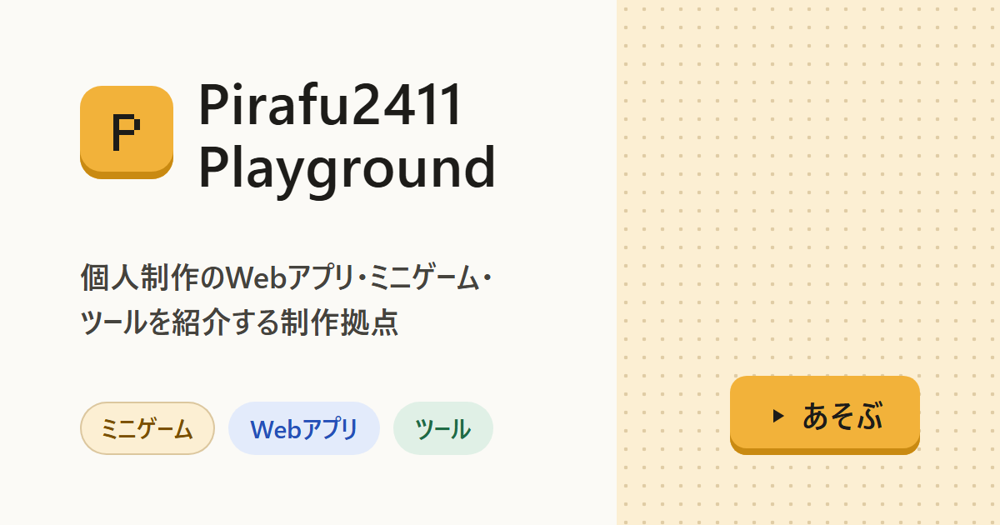

# Pirafu2411 Playground

Pirafu2411が個人で作ったゲームやWebアプリ、ツールの置き場です。

**サイト：https://pirafu2411.pages.dev**



## このリポジトリについて

このリポジトリには、作品を一覧・検索して紹介するPortalだけが入っています。作品本体はそれぞれ別のリポジトリで開発し、作品ごとのCloudflare Pagesで公開しています。Portalが持つのは作品のタイトル、説明、画像、公開先URLといった掲載情報だけで、作品のコードは含みません。

作品を掲載するときは、作品側に置いた設定ファイル（`pirafu.yaml`）を原本にします。[pirafu CLI](https://github.com/Termnix-IT/pirafu-cli) がこの設定を検証し、このリポジトリへ掲載用のPRを作ります。PRがmainへ取り込まれると、Cloudflare Pagesがサイトを再ビルドして公開します。作品とPortalを分けているので、作品を更新しても、登録PRを取り込むまでPortalの掲載内容は変わりません。

## 主な機能

- **トップ**：ピックアップ作品、更新履歴、カテゴリーの入口をタイルで並べ、その下にすべての作品を表示します。カテゴリーの切り替え、タイトル・タグの検索（入力に合わせてすぐ絞り込み）、開発状況での絞り込みができ、条件はURLに残ります。Ctrl/⌘+Kでどのページからでも検索へ移動できます。
- **作品ページ**：説明、紹介画像、作品情報、同じカテゴリーの作品を表示します。ブラウザで動く作品は、「あそぶ」「つかう」ボタンから別タブで開けます。
- **テーマ**：ライトとダークを切り替えられます。最初はOSの設定に合わせ、選んだテーマは次回も使われます。
- **このサイトについて**：サイトの説明と更新履歴を載せています。

画面の切り替えには View Transitions による演出を付けています。OSで「動きを減らす」設定をしている場合は、演出を止めて表示します。

## 技術構成

| 分類 | 使用しているもの |
| --- | --- |
| 画面 | React 19、TypeScript、React Router（宣言型ルーター） |
| ビルド | Vite |
| テスト | Vitest（単体・UI）、Playwright（ブラウザ操作） |
| 掲載情報の検証 | JSON Schema（`contracts/v1/`）と Ajv |
| フォント | Sora、Zen Kaku Gothic New（Fontsourceで同梱） |
| 公開 | Cloudflare Pages（GitHub連携。mainへのmergeで本番を更新） |

外部のCDNやWebフォント配信は使っていません。Content Security Policyで、同じオリジンのファイルだけを読み込むよう制限しているためです。フォントもnpmパッケージから配信物に同梱しています。

## 手元で動かす

Node.js 24.22.1（`.node-version`）と npm 11 が必要です。

```bash
npm ci
```

```bash
npm run dev
```

表示されたURL（127.0.0.1）をブラウザで開くと確認できます。作品の掲載情報や画像を変えたときは、開発サーバーを再起動してください。起動時に掲載情報を生成し直すためです。

変更を確認するときは、次のコマンドを使います。

```bash
npm run verify
```

`verify` は、Lint、型検査、単体・UIテスト、本番ビルド、配信物の検査を順に行います。配信物の検査では、許可していないファイル、非掲載作品の情報、停止中の公開先URLが配信物に含まれていないことも確かめます。

ブラウザ操作のテストは、初回だけChromiumを導入してから実行します。

```bash
npm run browser:install
```

```bash
npm run test:e2e
```

## ディレクトリ構成

| パス | 内容 |
| --- | --- |
| `src/` | 画面（`pages/`、`components/`、`styles/`）と、検索・絞り込みの処理（`features/catalog/`） |
| `catalog/` | 作品ごとの掲載情報（`projects/`）と元画像（`media/`） |
| `contracts/` | 掲載情報と作品側設定のJSON Schema、検証用の例 |
| `scripts/` | 掲載情報の生成・検証と、配信物の検査 |
| `public/` | セキュリティヘッダー、アイコン、SNS共有用の画像 |
| `tests/` | 単体・UIテストと、ブラウザ操作のテスト |
| `docs/` | 設計と実装計画 |

## 関連資料

- [設計と実装計画](docs/設計と実装計画.md)：設計の判断理由、データ契約、公開の手順、検証の記録
- [pirafu CLI](https://github.com/Termnix-IT/pirafu-cli)：作品の公開準備と、このPortalへの登録PRを作るコマンドラインツール
