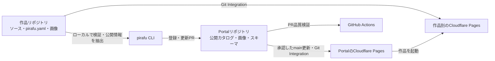

# Pirafu2411 Playground — 設計と実装計画

作成・公式資料確認日：2026-10-15（日本時間）

状態：Portalは https://pirafu2411.pages.dev で公開済み。CLIは別のローカルリポジトリに基本7コマンドを実装した。Phase 2Cではpublishの読み取り支援とregisterの計画・適用を追加した。Cloudflare実APIの疎通、実作品の独立公開、実GitHubへの登録PR作成・更新、CLI用GitHubリポジトリは未完了。操作方法と検証範囲は第10節を参照する。

この文書は、要件、設計判断、実装順序、受け入れ条件をまとめた実装・運用の基準である。設計承認と全機能の実装完了は区別する。実装済みの範囲と将来計画、公式資料で確認した仕様とアカウント上で未検証の事項を区別する。

## 1. 要件の理解と目的

### 制作物の公開と掲載を独立させる

Pirafu2411名義のWebアプリ、ミニゲーム、ツール、紹介作品を扱う制作拠点を構築する。Termnix-IT、`termnix-it.jp`、既存AWS環境から独立させる。既存環境の設定・DNS・認証・リソースを変更しない。

Portalは作品を見つけ、内容を理解し、利用先へ移動するためのカタログである。作品本体はそれぞれのリポジトリとホスティング先で動作する。CLIは公開準備、検証、連携状況確認、登録PR作成を担当する。この三者を個別に更新・検証できることを優先する。

MVPでは、静的Portal、Git管理の作品情報、`external`と`showcase`、必要最低限の仮UIを対象とする。認証、DB、Web管理画面、課金、ランキング、高度な解析、独自ドメイン、共通バックエンド、完成形のデザインは対象外とする。`embedded`と`download`は設計上の拡張位置を決めるが、MVPで動作可能と表示しない。

### 設計調査時の開発環境（実装前）

設計時の読み取り専用調査では次の状態だった。以下の表は実装前の記録であり、現在の接続・公開状態は第10節を参照する。Phase 1Aでは外部変更を行わず、Phase 1Bで承認された対象だけを接続した。

| 項目 | 確認結果 | 設計への影響 |
| --- | --- | --- |
| 作業フォルダー | 空。既存ソース、README、マニフェスト、ロックファイル、ローカルAGENTS.mdはない | 移行対象や既存実装の制約はない |
| Git | 2.53.0.windows.1。設計調査時はGit未初期化 | Phase 1Aで作業ブランチを初期化。remoteは未設定 |
| Node.js / npm | v24.13.1 / 11.8.0 | Portal開発の候補ランタイムとして利用可能 |
| Python | 3.14.3。短いPythonコードは終了コード0で実行できた | 実行時に実体位置の警告がある。Phase 2開始時にプロジェクト環境で再確認する |
| uv / GitHub CLI | uv 0.12.21 / gh 2.88.0 | 導入済み。GitHubのログイン先・権限は未確認 |
| Wrangler | PATH上に見つからない | 現段階では不要。必要なフェーズでバージョン固定して導入する |
| Python依存 | 現環境でPydantic、PyYAML、jsonschema、HTTPX、Pillowを検出。Typerは未検出 | グローバル環境をプロジェクトの依存解決結果として扱わない |
| Cloudflare / GitHub | アカウント、プラン、既存プロジェクト、対象リポジトリへの認証付き照会は未実施 | URL、権限、連携済み状態は未確認 |

ユーザー提示の作業指示を適用し、`implementation-researcher`のFull Researchとして既存構成、標準機能、追加依存、自作の範囲を比較した。公開仕様は公式資料で調査した。アカウント上の疎通試験、ビルド、デプロイ試験は設計承認後の作業である。

## 2. 推奨アーキテクチャ

### 独立した静的Portalと運用CLI



Portalはビルド時に作品情報を検証・取り込み、実行時は同一配信物だけを参照する。閲覧者のブラウザからGitHub API、Cloudflare API、各作品の`pirafu.yaml`を取得しない。CORS、API制限、トークン、外部サービスの一時障害が閲覧機能へ波及することを避ける。

作品の通常更新では作品側のPagesだけが更新される。作品説明・画像・リンクなど掲載内容を変更した場合だけ、登録PRを通じてPortalを更新する。Portalと作品のビルド成果物を共有しない。

CLI内部は「コマンド受付 → ユースケース → 検証・変換」と「GitHub / Cloudflare / ローカルプロセスのアダプター」に分ける。初期段階で汎用プラグイン基盤は作らない。Cloudflare固有のJSONやエラーをPortalの表示モデルへ持ち込まない。

### 技術選定と比較

| 領域 | 推奨 | 比較した選択肢と理由 |
| --- | --- | --- |
| Portal | React、TypeScript、Vite、npm | ユーザーの想定に合う。SSRフレームワークやDBはMVPに不要。Viteの公式React TSテンプレートを起点にする |
| ページ遷移 | React RouterのDeclarative Mode | History APIの自作では戻る操作、直接アクセス、404処理の保守が増える。フレームワークモードやサーバーローダーは導入しない |
| 状態 | Reactのローカル状態、URLSearchParams、純粋関数 | 小規模な静的検索にReduxやサーバーキャッシュ用ライブラリは不要 |
| デザイン | 意味的HTML、少量の通常CSS | UIキット、Tailwind、独自テーマの導入を初期要件にしない。仮UIを後から交換できる |
| データ契約 | JSON Schema Draft 2020-12を正本にする | TypeScript型だけではPythonや実データを検証できない。ZodとPydanticで別々に制約を定義すると不一致が起きる |
| Portal側検証 | Ajv 2020 + ajv-formats、ビルド時のみ | スキーマ評価器を自作しない。ブラウザへ検証器を含めず、CSPで動的コード生成を許可する必要をなくす |
| CLI | Python、Typer、Pydantic v2 | argparseでも可能だが、サブコマンド、help、型付き引数、テストを揃えやすい。PydanticはCLI設定と結果モデルに使用する |
| CLIの作品検証 | PyYAMLの安全な読込 + jsonschema | Portalと同じスキーマを直接評価する。作品制約をPydanticに再定義しない |
| API通信 | HTTPX、明示したタイムアウト・限定的リトライ | urllibでも可能だが、テスト用Transport、例外、接続制御を揃える利点がある。汎用APIクライアント基盤は作らない |
| GitHub操作 | Gitとghの既存機能 | PR、認証、Git送信を自作しない。引数配列で呼び、暗黙のforkやpushを抑える |
| 画像検証 | Portalの開発依存にSharp、CLIにPillow | 拡張子やヘッダーだけの検査では壊れた画像を排除できない。実デコード、寸法、形式、容量を検証する。両環境で共通fixtureを使う |
| テスト | Portal：Vitest、Testing Library、少数のPlaywrightシナリオ。CLI：pytest、Typer CliRunner | データ境界、利用フロー、副作用境界を検証する。実装をなぞるだけのテストは避ける |
| 依存管理 | Portalはpackage-lock.json、CLIはpyproject.toml + uv.lock | 新たなnpm workspaceや独自配布サーバーを不要にする。CLIは標準Pythonパッケージとしても導入可能にする |

React Routerの`BrowserRouter`、ViteのReactテンプレートとNode要件は公式資料で確認した。Node 24系を候補に、実装開始時に採用するバージョンと依存の互換性を確認し、ロックファイルへ固定する。[Vite](https://vite.dev/guide/)、[React Router](https://reactrouter.com/start/declarative/installation)

AjvとPython jsonschemaはDraft 2020-12に対応する。`format`だけではHTTPSや安全な接続先まで保証されないため、形式検査を有効にした上で追加の業務ルールを実装する。Pydanticからスキーマを生成する方法もあるが、Phase 1をPython依存にせず契約を独立させるため今回は正本としない。[Ajv](https://ajv.js.org/json-schema.html)、[jsonschema](https://python-jsonschema.readthedocs.io/en/stable/validate/)、[Pydantic](https://docs.pydantic.dev/latest/concepts/json_schema/)

自作するのは、作品情報の公開用変換、ID照合、画像の配置、変更計画、CLIコマンド間の手順に限定する。認証、暗号、YAMLパーサー、JSON Schema評価器、Gitプロトコル、汎用ビルド検出器は自作しない。

## 3. リポジトリ構成

### 最初から二つのリポジトリに分ける

Portalは`pirafu-playground`、CLIは`pirafu-cli`とする。設計時に空だった作業フォルダーをPortalの作業場所として使用している。フォルダー名の変更は必要ない。Portalの公開リポジトリは [Termnix-IT/pirafu-playground](https://github.com/Termnix-IT/pirafu-playground)。CLIはユーザーが準備した別フォルダーに独立したローカルGitリポジトリとして実装した。CLI用GitHubリポジトリはまだ作成していない。

以下は全体構成である。Portal部分はPhase 1A、CLIの基本3コマンドはPhase 2A、preview/statusはPhase 2B、publish/registerはPhase 2Cで実装した。各作品側の公開と実GitHubへの登録PRの実証は残る。

```text
pirafu-playground/
  src/
    app/                    # ルート構成・ページ遷移
    pages/                  # 一覧・詳細・サイト説明・未検出
    components/             # カード・ボタン・アイコンなどのUI部品
    features/catalog/       # 検索・絞り込み・表示用データ変換
    data/                   # 生成済みカタログを読む境界
    styles/                 # 画面全体のCSS（base.css）
  catalog/
    projects/<id>.json       # レビューする作品ごとの掲載レコード
    media/<id>/             # 元画像。public/直下へ置かない
    categories.json         # カテゴリーIDと日本語ラベル
  contracts/
    v1/                     # manifest / catalog のJSON Schema
    fixtures/               # 正常・異常データの共通契約テスト
  scripts/                  # 検証・配信対象データと画像の生成
  public/_headers           # 静的Portalのヘッダー
  tests/                    # データ契約・UI・主要遷移
  docs/設計と実装計画.md
  .github/workflows/ci.yml
  package.json
  package-lock.json

pirafu-cli/
  src/pirafu_cli/
    cli.py                  # Typerの入口・JSONと終了コードの統一
    services.py             # init/check/doctorの手順
    contracts.py            # 同梱契約の照合・作品制約
    files.py                # 厳密なYAML読込・パスの境界
    media.py                # 画像の実デコード検査
    processes.py            # 制限付きの診断プロセス
    cloudflare.py           # 対象PagesへのGET・認証と通信の境界
    status.py               # 本番と最新試行の判定・設定照合・待機
    preview.py              # プレビュー計画・起動・セッション停止
    preview_worker.py       # loopback配信・制御・子プロセス・TTL
    results.py              # Pydanticの結果・通知モデル
    contracts/v1/           # 特定版のスキーマと共通fixtureの同梱コピー
  tests/
  .gitattributes            # 同梱契約のハッシュを改行変換から保護
  pyproject.toml
  uv.lock
  .github/workflows/ci.yml

各作品リポジトリ/
  （既存の構成を維持）
  pirafu.yaml
  （必要な場合のみ、紹介画像・作品別CI・静的配信ヘッダー）
```

画像やカタログの生成物はGit管理対象に重複保存しない。ビルド時に`src`配下の無視対象の生成ディレクトリと`dist`へ出力する。元データの置き場をViteの公開ディレクトリと分け、非掲載画像まで自動コピーされることを防ぐ。

### スキーマの配布と互換性

Phase 1はPortalの`contracts/v1/`を契約の正本とする。Phase 2のCLIはレビュー済みコミットのスキーマとfixtureを同梱し、元のコミットとSHA-256を記録する。実行時に`main`や任意のURLからスキーマを取得しない。対応版がない場合は失敗させる。

スキーマ更新は正本の変更PRを先に作り、CLIの同梱コピーを更新する別PRで追従する。共通fixtureを両言語で実行し、形式検査と独自のID・HTTPS・パス検査の結果を揃える。スキーマを動的なクラウドサービスにせず、第三の契約リポジトリも初期段階では作らない。

未知フィールド拒否を採用するため、同じv1でも利用者が古ければ新フィールドを拒否し得る。契約配布物には独立したリビジョンを付け、追加時も対応するCLI最低版を明示する。必須化、意味の変更、既存データの解釈変更はv2とし、自動書き換えしない。

代替は`portal/`と`cli/`を持つ単一リポジトリである。初期PRをまとめやすいが、Node/PythonのCIや公開トリガーが混在する。既存コードがなく共有実装も少ないため、二つに分ける負荷は限定的と判断する。単一リポジトリを選んでも相互importを禁止し、契約とデータだけを境界にする。

## 4. Portalの責務と画面構成

### ルートと操作フロー

| URL案 | 必要情報・機能 | 主な責務 |
| --- | --- | --- |
| `/` | 制作拠点の説明、作品一覧、カテゴリー、開発ステータス、検索、featured表示 | 公開作品を検索・選択する |
| `/?q=...&category=...&status=...` | 絞り込み後の一覧、件数、条件解除 | 条件をURLで再現し、戻る操作を維持する |
| `/projects/:id` | タイトル、説明、カテゴリー、タグ、開発状況、画像、公開可能なリンク | 作品を理解して起動・参照する |
| `/about` | 運営名、サイトの目的、外部サービス・作品への案内 | Portal自体の説明をする |
| その他・未存在ID | 未検出メッセージと一覧へのリンク | アプリ内のNot Foundを表示する |

主な導線は「一覧 → 検索・絞り込み → 詳細 → 外部アプリ」である。`showcase`では起動ボタンを表示しない。起動無効の作品には利用不可を表示し、GitHubや説明を読む導線は独立させる。画像がない作品は、一覧カードではカテゴリーのアイコンタイルで代替し、詳細では画像領域を省略する。ゼロ件、画像の読込失敗、不明ID、長いタイトル、モバイル幅を確認対象にする。

検索対象はタイトルとタグを必須とし、説明文検索は初期対象外とする。Unicode正規化と大文字小文字を揃え、空白で分割した語をAND検索する。カテゴリー・ステータスとはANDで組み合わせる。featuredを先にし、その後は安定したタイトル順とIDで整列する。数百件程度を仮定し、全文検索サービス、ページング、検索用DBは導入しない。

詳細URLに安定IDを使用し、タイトルやホスティング名を変えてもURLを変えない。アプリ実行URLは`launch.url`で独立管理する。React RouterとPagesのSPA配信を使い、詳細ページへの直接アクセスと再読込を検証する。Pagesはトップレベルの`404.html`がない場合にSPAとしてルートを返すため、無条件に独自`404.html`を追加しない。この方式の不明ルートはHTTP上では200になり得る。[Serving Pages](https://developers.cloudflare.com/pages/configuration/serving-pages/)

### データとUIの境界

| 層・部品 | 責務 | 持たせない処理 |
| --- | --- | --- |
| catalog loader | 生成済み公開カタログを読み込む | 外部API、認証、作品ビルド |
| catalog selectors | 絞り込み、検索、並べ替え、ID検索 | DOM、CSS、外部通信 |
| route / page | URL条件と表示状態、ページタイトル、画面構成 | CloudflareやGitHubのAPI形式 |
| SearchForm / FilterControls | ラベル付き入力、条件変更通知 | データの永続保存 |
| ProjectList / ProjectSummary | 作品要約と詳細へのリンク | データ取得、独自の掲載可否判定 |
| ProjectDetails / MediaGallery / LaunchAction | 詳細情報、画像、許可された操作 | 外部公開、CLI実行 |

コンポーネントは型付きデータとイベントを受け取る。検索・掲載ルールは純粋関数としてテストできる形にし、JSXやCSSの変更でルールを移植しなくて済むようにする。将来のClaude Codeによる再設計では`pages/`、`components/`、`styles/`を広く変更できる。

画面は`header`、`nav`、`main`、`section`、`article`、見出し、リスト、実際のリンクとボタンを使う。クリック可能なdiv、色だけの状態表現、ホバーだけの操作を避ける。フォームラベル、フォーカス表示、キーボード操作、スキップリンク、画像代替テキスト、ページ遷移時のタイトルとフォーカス、検索結果件数の通知を確認する。狭い幅では縦に並び、画像は領域内に収める。

画面デザインは、画像付きカードのグリッドを土台に、遊び心のある要素を加えた構成である。カテゴリーは検索語と開発状況を保ったまま切り替えるリンク（チップ）で選び、フォームで送るのは検索語と開発状況だけにする。featured作品は一覧の先頭で横幅いっぱいのピックアップカードとして表示し、別枠に重複して載せない。起動リンクはアンバー色のボタンで示し、ミニゲームは「あそぶ」、それ以外は「つかう」と表示する。リンク名には「（別タブ）」を含める。開発状況は形の異なる記号と文字で示す。詳細には同じカテゴリーの作品を最大3件表示する。

演出は5種類に限る。初回表示ではカードが順にせり上がる（スタッガー表示）。ページ遷移と絞り込みでは、カード画像とタイトルが詳細の同じ要素へつながって移動し、残るカードは新しい位置へ滑る（共有要素モーフとFLIP並び替え）。カードはホバーで浮いてアイコンが揺れ、画像なしタイルのドット柄が流れる。起動ボタンは押すと沈んで跳ね返り、定期的に光が横切る。遷移はReact 19の`<ViewTransition>`とブラウザのView Transitions APIで実装しており、`BrowserRouter`がURL更新を`startTransition`で反映することを前提にする。`useTransitions={false}`を指定すると遷移演出は動かなくなる。未対応ブラウザでは演出なしで切り替わる。`prefers-reduced-motion: reduce`では、アニメーションと遷移演出をCSSで止める。

字体はシステムフォントとする。CSPが同一オリジンのCSS/JSだけを許可し、配信物検査も`assets/`のJS/CSSと生成画像以外のファイルを拒否するため、外部Webフォントは読み込めない。フォントを同梱する場合は、ライセンス確認に加えて配信物検査の許可対象も変更する。配色や余白は`styles/base.css`冒頭のCSS変数にまとめている。

## 5. 作品メタデータのスキーマ

### 三つの状態を混同しない

1. `project.status`：開発状況。`planned / in-development / stable / maintenance / archived`。
2. `project.visibility`：希望するPortal掲載状態。`public / unlisted / hidden`。
3. デプロイ観測結果：`pending / building / success / failed / unknown`など。Cloudflareから取得する一時的な情報であり、開発状況や掲載状態へ自動転記しない。

`public`は一覧と詳細を公開、`unlisted`は一覧と検索から除外して詳細を公開、`hidden`は配信データと画像から除外する。`unlisted`はアクセス制御ではなく、URLや配信データから発見可能である。Gitの公開履歴や過去デプロイから情報を消す効果もない。メタデータには、どの掲載状態でも秘密情報を入れない。

Portal側では後述の`publication.visibility`を最終的な掲載状態にする。初回登録では`project.visibility`から設定するが、更新時に運営者の停止判断を自動解除しない。

### マニフェスト案

以下は公開後の`external`作品の例であり、URL・リポジトリの実在や取得可能性を表さない。ホストには予約済みの例示用ドメインを使用している。

```yaml
schemaVersion: 1
project:
  id: sample-mini-game
  title: サンプルミニゲーム
  description: ブラウザで遊べるサンプル作品です。
  category: games
  status: stable
  visibility: public
  tags: [puzzle, browser]
hosting:
  provider: cloudflare-pages
  mode: git
  projectName: pirafu-sample-mini-game
  productionBranch: main
  rootDirectory: .
  buildCommand: npm run build
  outputDirectory: dist
launch:
  type: external
  url: https://app.example.com/
links:
  repository: https://github.com/example/sample-mini-game
catalog:
  featured: false
  thumbnail:
    path: media/thumbnail.webp
    alt: サンプル作品のタイトル画面
  screenshots:
    - path: media/play.webp
      alt: パズルのプレイ画面
```

例の`launch.url`はデータの形を示すものにすぎない。実際のCloudflare作品の登録時は、APIで確認した本番ホストとの一致が必要になる。

最小の`showcase`例：

```yaml
schemaVersion: 1
project:
  id: sample-internal-tool
  title: 管理ツールの紹介
  description: 公開可能な説明だけを掲載する作品です。
  category: tools
  status: maintenance
  visibility: public
  tags: []
hosting:
  provider: none
  mode: none
launch:
  type: showcase
catalog:
  featured: false
  screenshots: []
```

### 必須・任意と制約の提案

| フィールド | 必須条件・内容 |
| --- | --- |
| `schemaVersion` | 必須。整数`1`。未知版を黙って読み替えない |
| `project.id` | 必須。不変。`^[a-z][a-z0-9]*(?:-[a-z0-9]+)*$`、最大64文字。Windows予約名も拒否。削除・非掲載後も再利用しない |
| `project.title` | 必須。空白のみを不可、1〜100文字 |
| `project.description` | 必須。プレーンテキスト、1〜4000文字。HTML・任意Markdownは実行しない |
| `project.category` | 必須。初期は`apps / games / tools / other`。Portalのカテゴリー辞書と照合 |
| `project.status` / `project.visibility` | 必須。前述の列挙値 |
| `project.tags` | 任意。省略時は空配列。最大12件、各1〜32文字、正規化後の重複不可 |
| `hosting.provider` / `hosting.mode` | 必須の組。MVPの管理対象は`cloudflare-pages + git`。紹介のみは`none + none`。既存外部サイトは`external + unmanaged` |
| `hosting.projectName` | Cloudflareの場合必須。作品IDやPortalリポジトリ名とは独立。v1のローカル契約では58文字以下・末尾英数字に制限するが、Cloudflareの全許容範囲と同一とは未確認。接続時に実APIと照合する |
| `hosting.productionBranch` | Cloudflare Gitの場合必須。`main`を初期提案とし、既存作品では実際のブランチを優先する |
| `hosting.rootDirectory` | Cloudflareの場合必須。リポジトリ基準の相対ディレクトリ。既定案は`.` |
| `hosting.buildCommand` | Cloudflareの場合は文字列として必須。ビルド不要の静的作品では空文字を許可。クラウド上のコマンドであり、ローカルで暗黙実行しない |
| `hosting.outputDirectory` | Cloudflareの場合必須。rootDirectory基準の相対パス。静的作品では`.`を許容するが、配信対象の混入検査が必要 |
| `launch.type` | 必須。v1実装は`external / showcase`のみ。未対応方式は明確なエラー。将来、方式ごとの分岐を追加する |
| `launch.url` | `external`の登録時に必須。`init`直後は未設定を許し、登録用検査で拒否する。`showcase`では禁止 |
| `links.repository` / `links.website` | 任意。公開してよいHTTPS URLのみ。非公開リポジトリの名前を自動露出させない |
| `catalog.featured` | 任意。省略時false。掲載順への希望として扱い、Portal運営者がレビューする |
| `catalog.thumbnail` | 任意。`path`と非空の`alt`の組 |
| `catalog.screenshots` | 任意。最大8件。各要素は`path`と非空の`alt`。省略時は空配列 |
| `local.build` / `local.preview` | 任意の追加フィールド案。実行ファイルと引数の文字列配列。ローカル実行を必要とする場合に指定する。秘密情報を含めない |

全オブジェクトで未知フィールドを原則拒否する。YAMLは単一ドキュメント、JSONへ変換可能な型に限定し、重複キー、独自タグ、アンカー・エイリアス、非有限数、過大な入力を拒否する。入力上限は256 KiB案とする。安全なYAML読込機能を利用し、コードを構築するローダーを使用しない。[PyYAML](https://pyyaml.org/wiki/PyYAMLDocumentation)

`rootDirectory`と`outputDirectory`の関係、ファイルの存在、実パス、シンボリックリンク、ID重複などはJSON Schemaだけでは検証できない。スキーマ検査に続いてファイル・カタログ検査を行う。各パスは実パスへ解決後も許可したリポジトリ内に収まる必要がある。絶対パス、ドライブ指定、UNC、`..`による脱出を拒否する。

`local.build`と`hosting.buildCommand`はそれぞれローカル実行とクラウド実行の設定である。標準テンプレートでは同じnpmスクリプトを使う。異なる場合は`check`で差異を表示する。任意のシェル文字列を推測して引数分解しない。Nodeを使わない作品では必要な配列を明示し、テンプレート外を勝手に実行しない。

### URL・画像・本番URLの整合性

公開URLはHTTPSの絶対URLに限定し、userinfo、認証用クエリー、`javascript:`、`data:`、`file:`、ローカルホスト、プライベートIP、リンクローカル、内部向けホストを拒否する。`launch.url`はアプリのサブパスとfragmentを許容するが、MVPではqueryを禁止して一時トークンの掲載を避ける。URL検査とネットワーク到達確認は別の検査結果とする。

Cloudflare管理作品では、選択したアカウントと`projectName`からプロジェクト情報、本番の有効なデプロイ、Gitソース、productionBranch、build設定を照合する。URLは取得した`subdomain`を使い、名前から組み立てた推測を確定値にしない。`latest_deployment`はプレビューの可能性があるため、`canonical_deployment`、環境、状態と現在の本番の参照先を確認する。ロールバック時はmainの最新SHAとの違いも表示する。過去の「最新成功」だけを「現在の本番」と誤表示しない。APIの例示レスポンスだけではrollback時の参照更新まで保証できないため、その動作はPhase 1Bで実測する。[Get project API](https://developers.cloudflare.com/api/resources/pages/subresources/projects/methods/get/)

本番ホストと`launch.url`のホストが異なる場合、MVPでは登録を止める。将来の独自ドメインは別途検証を追加する。ハッシュ付きデプロイURLやブランチのプレビューURLを本番として登録しない。HTTP 200だけではSPAのfallbackと正常な起動を区別できないため、公開受け入れでは人による操作確認も行う。

画像は作品リポジトリ内のローカルPNG/JPEG/WebPのみを初期対応にする。SVG、GIF、任意の外部画像取得、HTMLを除外する。1画像2 MiB以下、縦横各4096px以下、静止画のみ、最大8枚のスクリーンショットを提案する。マジック値だけでなく実デコードを行い、形式・寸法・容量を検査する。登録時に再エンコードして位置情報などの付帯情報を除去し、内容ハッシュ付きの安全なファイル名でコピーする。ライセンスと公開可能な画面内容はレビュー対象とし、CLIが合法性や秘密情報の不存在を保証したとは扱わない。

### Portalカタログへの変換

作品側`pirafu.yaml`は作品情報の原本、Portal側`catalog/projects/<id>.json`は掲載承認されたスナップショットとする。作品側の変更だけでは掲載内容は変わらない。Phase 1では手動で同じ公開レコードを作成し、Phase 2でCLIが差分を作成する。

公開レコードは`schemaVersion`、公開可能な`project`、`launch`、`links`、`catalog`と、Portal管理の`publication`を持つ。`publication`は`visibility`と`launchEnabled`を必須にする。初回は作品側の希望を提案し、更新時は既存値を維持する。掲載停止や起動停止の解除は明示した差分とレビューを必要とする。`hosting`、`local`、アカウントID、実行コマンド、非公開リポジトリ識別子は公開レコードへコピーしない。

画像パスはPortal管理のメディア参照へ変換する。ビルド時に有効な掲載状態を判定し、hiddenのデータと画像、launchEnabledがfalseの起動URLを配信物から除外する。停止中のexternal作品は、その起動URLと同じ場所を指す関連リンクも除去する。比較ではURLを正規化し、fragmentを除いて判断する。独立した別パスの関連リンクは保持する。この処理はホスティングへのアクセス制御ではない。内部の掲載レコード自体も公開Gitリポジトリでは閲覧可能である。紹介文、画像、元ファイルに秘密情報を保存しない。

`register`はIDでupsertする。同じ内容なら変更もPRも作らない。既存IDに別作品を重ねないよう、新規と更新を区別し、既存IDの変更には`--update`を要求する。公開リポジトリのリンクが変わる場合は衝突として止め、名称変更・移管かを確認する。非公開作品についてリポジトリ所有権を機械的に証明する仕組みはMVPにはなく、Portal運営者のPRレビューを信頼境界とする。

取り下げ後も非配信の掲載レコードを維持し、IDを予約する。通常の追加登録にはPortalコードの修正を不要にする。カテゴリー追加、公開方式追加、契約変更は通常の作品追加と分けてレビューする。

## 6. CLIのコマンド仕様

### 共通の副作用と出力契約

全コマンドに`--dry-run`、`--json`、`--non-interactive`、`--config PATH`を用意する。オフラインで完結できる検査には`--offline`を用意する。`--dry-run`はローカルのファイル・Git・外部サービスを変更せず、ビルド・サーバー・認証操作も開始しない。読み取りAPIは利用してよいが、`--offline`併用時は通信も行わない。

`--json`時のstdoutは、結果を表すJSONオブジェクト一つだけとする。進捗、警告、子プロセス出力はstderrへ分離し、秘密情報を削除する。子プロセス出力の取り込みは容量制限を設ける。JSONモードと非対話モードでは入力待ちをしない。

結果の共通キーは`apiVersion`、`command`、`outcome`、`dryRun`、`data`、`changes`、`warnings`、`errors`、`nextActions`とする。各エラーは安定した`code`、人向け`message`、可能なら`field`と`hint`を持つ。キーを英語、初期の人向け表示を日本語にする。`unknown`と失敗、未確認と成功を区別する。

```json
{
  "apiVersion": 1,
  "command": "publish",
  "outcome": "needs_action",
  "dryRun": true,
  "data": {"projectId": "sample-mini-game"},
  "changes": [],
  "warnings": [],
  "errors": [],
  "nextActions": [
    {"code": "CONNECT_GIT_MANUALLY", "message": "管理画面で対象リポジトリを連携してください"}
  ]
}
```

| 終了コード案 | 意味 |
| --- | --- |
| 0 | 完了、差分なし、または実行可能なdry-run計画を作成 |
| 1 | 予期しない内部エラー。安全な要約を返す |
| 2 | 引数・設定・スキーマ不正、未対応版 |
| 3 | 検証不合格、必要ツールなし、ビルド失敗 |
| 4 | 認証・権限不足 |
| 5 | 手動設定・承認待ち、操作キャンセル。公開完了とは扱わない |
| 6 | 外部API・通信失敗、待機期限切れ |
| 7 | ID、Git、既存設定、更新対象の競合 |
| 130 | ユーザーによる中断 |

読み取りのdry-runでも前提不備があれば該当エラーを返す。JSON例は未連携のため終了コード5になる。スキップした検査は結果内に理由を残し、必要な検査が未実施なら公開可能とは判定しない。

| コマンド | 既定動作 | 書込・外部変更と注意 |
| --- | --- | --- |
| `init` | 構成を候補として検出し、作品ID・設定・公開方式を提示 | `pirafu.yaml`のみ生成。既存ファイルを上書きしない。明示した更新時は差分を確認。技術スタックやmainを推測だけで確定しない |
| `check` | スキーマ、パス、画像、ID、公開用情報の検査 | 既定でビルドや外部通信をしない。`--target local/publish/register`で必要条件を分ける。`--online`でAPI・HTTP確認、`--build`で承認されたlocal.buildを実行する |
| `preview` | 検証後、local.previewを提示して起動 | ローカルプロセスと一時ポートを使用。127.0.0.1のみ。静的成果物用の簡易サーバーはリポジトリ全体を公開しない。外部トンネルやCloudflareプレビューは作らない |
| `publish` | 公開前検査、既存Pages・Git連携・設定差異の確認、初回設定案内 | MVPはGit接続の手動作業を許容し、API作成、設定更新、mainへのpush、Direct Upload、deploy hook呼出しを自動実行しない |
| `register` | 公開レコードと画像の差分を作成し、専用ブランチのPRへ反映 | Portal作業コピー、カタログ、画像、専用commit、作業ブランチpush、PR作成・更新。適用前に対象remote/base、全差分、Pagesプレビュー発生の可能性を提示 |
| `status` | 設定とPagesの現在の本番、最新試行、Git SHA、URL、失敗を取得 | 読み取りのみ。`--wait`は期限付き。未連携・権限不足・unknownを区別。未検証の推測URLを返さない |
| `doctor` | 必要ツール、バージョン、選択先、認証利用可否を診断 | 自動インストール・ログインしない。トークンやアカウントの機密情報を表示しない。offline時は認証疎通を未確認として返す |

`check --target local`はURL未設定でも構造とローカル資材を検査できる。`--target publish`はCloudflare用設定とビルド成果物を要求する。`--target register --online`では実際の本番URLとの照合を要求する。`showcase`はホスティング認証なしで登録可能とする。`register`は実行前に適用対象の全検査を自動実行し、利用者が先行コマンドを忘れても通過させない。

ローカル検査でPortalカタログを参照できない場合、全体のID重複は未確認と表示する。登録時には最新baseの全レコードで重複を検査し、PRのCIでも再確認する。`external + unmanaged`はCloudflareのプロジェクト照会を行わず、HTTPS形式と運営者の公開先確認を必要条件にする。

`preview --json`はサーバーをバックグラウンドで起動し、URL・PID・セッションID・停止コマンドを一度返してCLIは終了する。`--non-interactive`も同じ方式とする。通常はフォアグラウンドで起動してCtrl+Cで停止する。ポート・起動期限・TTLを設ける。停止は認証付きloopback制御口で行い、保存されたPIDを直接killしない。長期監視やOSサービス化は対象外。詳細と両OSでの試験結果は第10節を参照する。

### 承認と再実行

ファイル生成やローカルコマンドを含め、変更は事前表示する。外部変更を伴う`register`は既定を計画表示にし、`--apply`で適用を選ぶ。対話モードでは差分確認後に確認入力、非対話では`--apply --yes`の明示を必須とする。`--json`のみでは適用しない。将来のCloudflare変更も同じ原則を使う。`--yes`は資格情報や対象の検査を迂回しない。

計画表示後にbase SHA、ファイル、既存PR、リモート設定が変わった場合は再計画する。承認された差分以外をまとめてcommitしない。起動するローカルコマンドは引数を提示し、明示した実行オプションを承認として扱う。任意リポジトリのビルドはコード実行であり、メタデータ検査だけで安全性が保証されるわけではない。

登録対象のPortalは明示した`--portal-repo owner/repo --base main`等で確定する。隔離した一時cloneを使い、利用者の作業ツリーやstage状態を変更しない。`pirafu/register/<id>`の専用ブランチとPRを照合する。同一内容はno-op、既存のopen PRは対象・所有・差分を確認して更新し、他者の変更があれば停止する。通常pushで更新できない場合、force pushやブランチ再作成で解消しない。PR作成だけが失敗したときも、再実行で既存ブランチを回収して重複PRを作らない。

一時cloneは適用段階で作る。dry-runの計画は、GitHubの読み取りAPIとメモリ上の差分で作成し、clone、fetch、キャッシュ更新、一時画像生成も行わない。offline時に必要なPortal情報が指定されていなければ、ローカルで検査できる範囲と不足情報を返し、適用可能な登録計画が完成したとは表示しない。

`gh pr create`は明示したhead/baseを使う。`gh pr create --dry-run`もGit変更をpushする可能性が公式に記載されているため、`pirafu --dry-run`では呼ばない。PR本文は一時ファイルから`--body-file`で渡す。[gh pr create](https://cli.github.com/manual/gh_pr_create)

Windowsではnpm.cmd等の起動方法をアダプターで扱い、Unix向けのシェル引用符を流用しない。一般のプロセスは引数配列で実行し、メタデータや作品IDをシェルコマンドへ文字列連結しない。バッチ起動が必要な場合も既知のラッパーに限定し、空白・日本語パス・引用符・不正なメタ文字を代表ケースとして検証する。

## 7. Cloudflare Pagesの公開方式とGitHub連携

### 標準はGit Integration

Portalと各作品を、それぞれGitHubリポジトリと一つのPagesプロジェクトに接続する。本番ブランチは原則`main`だが、既存作品は実態と整合させる。作品とPortalの変更イベントを独立させる。

Git Integrationではpushからビルド・デプロイを開始できる。プロジェクト方式を後から自由に切り替えられるわけではない。Git連携プロジェクトは方式自体をDirect Uploadへ切替できないが、自動デプロイを停止してWranglerで配信する運用は公式に案内されている。Direct Uploadで作ったプロジェクトからGit Integrationへの切替もできない。初回選択を承認事項にする。[Git integration](https://developers.cloudflare.com/pages/configuration/git-integration/)、[Direct Upload](https://developers.cloudflare.com/pages/get-started/direct-upload/)

PagesのCreate APIには`source`設定があり、Gitソースを持つプロジェクトの作成データは表現できる。ただしAPIだけで初回GitHub App認可・インストールを完結できるとは確認できていない。ユーザーのアカウントでの作成・連携は未検証であり、MVPは管理画面での初回接続を標準とする。CLIは必要な入力と確認手順を提示し、接続後に読み取りAPIで実態を照合する。[Create project API](https://developers.cloudflare.com/api/resources/pages/subresources/projects/methods/create/)

### 初回公開の実施手順案

1. 公開する作品、GitHub owner/repository、公開可能なデータ、希望Pages名を決める。
2. `init`と`check`で設定を作成・検証する。ビルドは明示したローカルコマンドで行う。
3. PR品質検証と本番ブランチ保護を先に用意する。公開承認前のmain更新が勝手に公開されない順序にする。
4. 接続・初回公開の対象と影響を提示し、承認を得る。Git連携設定直後に初回ビルド・公開が始まり得るため、接続自体を公開操作として扱う。
5. Cloudflare管理画面でPagesを選び、GitHub Appに対象リポジトリのみのアクセスを許可する。既存Termnix-IT関連の連携を変更しない。
6. projectName、productionBranch、rootDirectory、buildCommand、outputDirectoryを設定する。PortalはViteの`dist`を出力する。
7. 非公開にしたいプレビューは、先にプレビュー自動ビルドを停止し、Accessの設定後に必要な範囲で有効化する。初期設定中も非公開情報を含めない。
8. 初回デプロイの成功、本番URL、Git SHA、ヘッダー、直接アクセス、主要操作を確認する。
9. 作品の`launch.url`へ確認済みURLを設定し、`register`でPortal登録PRを作る。
10. PRのデータ検証とレビュー後、明示した公開承認の範囲でmergeし、Portal掲載を確認する。

PagesのReact向けガイドでビルドコマンド`npm run build`と出力`dist`を確認した。実際のPortalではデータ検証と型検査をビルドスクリプトへ組み込む。NodeのバージョンはPagesのデフォルトに任せず、`.node-version`等でローカル・CIと揃える。Nodeバージョンの上書きは公式に対応する。[React on Pages](https://developers.cloudflare.com/pages/framework-guides/deploy-a-react-site/)、[Build image](https://developers.cloudflare.com/pages/configuration/build-image/)

Portalでは承認後にPagesプロジェクト`pirafu2411`を作成し、実際の公開URLが https://pirafu2411.pages.dev であることを確認した。`pirafu-playground`というGitHub名とPagesプロジェクト名が一致する必要はない。各作品も実際に発行されたホストを登録し、候補名を確定URLとしてコードへ埋め込まない。

### プレビューと作品ごとの例外

同一リポジトリ内のPRではPagesプレビューを利用できるが、fork由来PRのプレビューURLは作成されない。ブランチaliasと過去のハッシュURLは役割が異なり、古いハッシュURLが残ることがある。プレビューは既定で公開される。PagesのAccess設定はプレビューを保護し、通常の本番`pages.dev`や独自ドメインを同時に保護する設定ではない。[GitHub integration](https://developers.cloudflare.com/pages/configuration/git-integration/github-integration/)、[Preview deployments](https://developers.cloudflare.com/pages/configuration/preview-deployments/)

公開可能なPortalでは公開プレビューも選択肢にする。内部向け作品は掲載形式を`showcase`にし、実管理環境をPagesへデプロイしない。プレビュー保護の必要性はリポジトリごとに判断する。

HTML/JSはビルド不要の専用配信ディレクトリ、React/Viteはlockfileとnpmスクリプト、GodotはWeb exportの成果物を扱う。Godotの大きなWASM/PCKやマルチスレッドは個別に制約を確認する。Threads使用時にはSharedArrayBufferとクロスオリジン分離のヘッダーが必要になるため、Portalへ一律適用せず作品側で設定する。[Godot Web export](https://docs.godotengine.org/en/stable/tutorials/export/exporting_for_web.html)

## 8. CI/CDフロー

### 品質ゲートとデプロイを分担する

```text
作業ブランチ → PR → GitHub Actionsの必須品質チェック
                    └→ Pagesプレビュー（有効な場合。Actionsと並行）
         → 最新baseとの整合性確認・公開承認 → mainへmerge
         → Pagesがmainをビルド → デプロイ成功 → 本番確認
```

GitHub ActionsはPagesのGit Integrationを順番待ちさせる仕組みではない。PRのCIが失敗していてもプレビューのビルドは動き得る。mainへ直接pushできれば、mainのActionsが失敗してもPages本番公開が進み得る。Actionsの完了をPagesが自動的に待つ前提を置かない。

対策はmainにPR経由更新、必要チェック成功、最新baseとの整合性、迂回制限を設定することである。個人開発ではPR作成者が自分のPRを承認できないため、外部レビュー担当がいない限り「承認レビュー1名必須」を無条件に設定しない。品質チェック必須と、人による公開内容の確認を分ける。[Protected branches](https://docs.github.com/en/repositories/configuring-branches-and-merges-in-your-repository/managing-protected-branches/about-protected-branches)、[Required reviews](https://docs.github.com/en/pull-requests/how-tos/review-pull-requests/approving-a-pull-request-with-required-reviews)

ブランチ保護の利用可否はGitHubプランとリポジトリの公開範囲に依存する。Freeの公開リポジトリは対応するが、非公開リポジトリの条件は契約確認が必要である。利用できない場合に「CIで本番を保護済み」とは扱わない。手動公開、対応プラン、別のデプロイゲートを代替案として承認を得る。

### リポジトリ別の検査

| 対象 | PRの品質確認 | Pages側の処理 |
| --- | --- | --- |
| Portal | npm ci、Lint、TypeScript、契約fixture、全掲載レコード・ID・画像検査、検索と詳細のテスト、production build、主要ブラウザ遷移 | lockfile準拠の依存導入、データ検証、型検査、production build、dist検査、配信 |
| CLI | 固定したPython環境、Ruff、pytest、契約fixture、パッケージbuild、インストール・helpのsmoke test、秘密情報マスキング・副作用境界 | CLI自身はPagesへ配信しない。初期配布はローカル導入。PyPI公開は別承認 |
| HTML/JS作品 | マニフェスト・配信ファイル・リンクの検査、必要な静的検査、起動確認 | ビルドなし、指定した配信ディレクトリを使用 |
| React/Vite作品 | 作品自身のLint・test・build + マニフェスト・出力検査 | その作品のビルド設定で実行 |
| Godot作品 | 固定したGodot版・export templateでWeb export、成果物サイズ・ヘッダー・起動確認 | 承認したexport手順をPagesで実行できるか作品ごとに検証。不適合なら別方式を提案 |

Portalは必須の集約チェックを常に完了させる。pathフィルターで必須ワークフロー自体が起動しない構成を避け、変更がない検査はジョブ内で省略理由を扱う。外部URLの到達確認は通信障害で通常CIを不安定にするため、スキーマ・HTTPS・内部パス検査は必須、ネットワーク確認は登録前のオンライン検査と公開時のsmoke testに分ける。

CLIのコマンド・パス・プロセス試験はWindowsとUbuntu、Pythonは最低対応版と採用版で実行する。初期の最低対応候補は3.12、採用候補は3.14とし、実装開始時の依存解決とwheel提供で確定する。Portalの主CIはUbuntu、可搬性確認はWindowsでもclean installとbuildを行う。

### 二重ビルドの扱い

Git Integrationを維持するMVPでは、PRでのbuild検証とPagesでのbuildは重複する。PagesがActionsの成果物をそのまま昇格させる設計ではないため、完全にはなくせない。Actionsでdeployせず、Pages側で全unit testを重ねず、docsだけの変更はPagesのbuild watch pathsで除外する。manifest、lockfile、ビルドスクリプト、画像、スキーマは除外しない。[Build watch paths](https://developers.cloudflare.com/pages/configuration/build-watch-paths/)

Pagesのbuild commandには最低限のデータ検証と成果物検査を含める。これにより不正な配信物の公開を止めるが、全Actionsの代替にはしない。ActionsとPagesのビルド条件が同一でも同一バイトの成果物を保証するわけではなく、再現性が強く必要になった場合は「CIで一度だけbuild → Direct Upload等による配信」を別途比較する。

失敗検知はPhase 1からGitHubのチェックとPagesの履歴・ログを利用する。デプロイ成功判定は設定変更の受理ではなく、該当SHAの本番デプロイ成功とURLでの確認を必要とする。自動的な継続監視・通知基盤はPhase 4で扱い、初期は失敗時に履歴とmainのSHAを照合する手順を用意する。

### ロールバックと公開停止

ロールバック手順：

1. 対象プロジェクト、現在の本番、問題のSHA、戻す成功済み本番デプロイを確認する。
2. 誤って再公開されることを防ぐため、必要に応じて承認の上で本番の自動デプロイを一時停止する。
3. PagesのDeploymentsで対象の成功済み本番デプロイの「その他の操作」から「この展開にロールバックする」を選び、確認後に本番URLと主要操作を確認する。プレビューデプロイはrollback対象にできない。
4. Git側にもrevert等の通常PRを作り、mainと本番の不整合を解消する。過去commitの履歴書換えは行わない。
5. 原因を修正・検証し、自動デプロイを再開する。次のデプロイでrollbackが上書きされることを確認する。

成功済み本番デプロイへのrollbackと、プレビューが対象外であることは公式資料で確認した。Phase 1Bでは同じソースSHAの成功済み本番を二つ用意し、旧デプロイへの切り替えと検証前のデプロイへの復旧を試験した。異なるソースへの切り戻しやGitのrevertは今回の試験対象外である。[Rollbacks](https://developers.cloudflare.com/pages/configuration/rollbacks/)

公開停止は三つに分ける。

- 掲載停止：Portal側`publication.visibility=hidden`をPRで反映する。作品本体への直接アクセスは止まらない。
- 起動案内の停止：`publication.launchEnabled=false`を反映する。紹介を残して起動URLの配信を止めるが、知っているURLからのアクセスは止まらない。
- ホスティング停止：対象作品側で停止用の配信物へ置換する等、承認した方法で実施する。過去のハッシュ付きURL、プレビュー、キャッシュも確認する。自動デプロイを止めるだけでは既存配信は止まらない。

完全なアクセス遮断や秘密情報漏えい時は通常の掲載停止と別扱いにし、資格情報の失効、公開履歴・過去デプロイの対処、必要なAccess設定やプロジェクト削除を具体的に検討する。Pagesの過去デプロイには削除の制約がある。今回ホスティングの完全停止、過去デプロイ削除、Access保護は試験していないため、完全遮断の手順は実証済みと扱わない。CLIは停止・削除をMVPで自動化しない。

## 9. セキュリティ・認証設計

### 権限をブラウザに渡さない

Portalは匿名の静的閲覧のみ。ブラウザ配信物にCloudflare、GitHub、管理環境への資格情報を含めない。Viteの公開環境変数も秘密情報の置き場にしない。APIアカウントIDや内部のローカルパスはCLIの利用者設定で持ち、公開マニフェストやPRにコピーしない。

| 用途 | 推奨認証・権限 | 境界 |
| --- | --- | --- |
| Cloudflare Git連携 | Cloudflare公式GitHub App | 選択リポジトリだけに許可。既存連携の削除やAll repositoriesへの拡大をしない |
| CLIのPages照会 | 対象アカウントに限定したPages Read token | 初期CLIは読み取りのみ。作品単位への権限分割が可能とは前提にしない |
| 将来のPages変更 | 明示した対象アカウントのPages Write token | Read tokenと分離。実装・承認が必要になるまで発行を要求しない |
| ローカルのGitHub | ghの認証とGit credential manager / SSH | CLI独自のtoken保存を作らない。対象remoteとhead/baseを確定する |
| GitHub自動化用tokenを使う場合 | 対象リポジトリに限定したfine-grained token等を再評価 | Contents write、Pull requests writeなど必要操作に限定。管理者権限を要求しない |
| GitHub Actions | 既定`contents: read`のGITHUB_TOKEN | 品質検証にCloudflare tokenやPR作成権限を与えない |

Pages照会APIはPages ReadまたはPages Write、作成APIはPages Writeを受け付ける。権限のアカウント内での実際の範囲、契約、利用者ロールは未確認であり、プロジェクト単位に制限できると断定しない。[Get project API](https://developers.cloudflare.com/api/resources/pages/subresources/projects/methods/get/)、[Create project API](https://developers.cloudflare.com/api/resources/pages/subresources/projects/methods/create/)

Cloudflare tokenは利用者の実行環境から注入する。CLIの初期実装は平文の独自認証ファイルやCLI引数でtokenを受け取らない。ghはOSの資格情報ストアを利用できるが、利用できない場合は平文ファイルへfallbackする仕様がある。doctorはtokenを出力せず保存方式と利用可否を診断し、平文保存を安全な保存済み状態と誤認させない。[gh auth login](https://cli.github.com/manual/gh_auth_login)

Cloudflare APIのレスポンスには環境変数などの管理情報も含まれ得るため、生のレスポンスをstdout、エラー、debugログ、PR本文へ出力しない。statusのJSONは、プロジェクト名、本番URL、状態、時刻、必要なGit SHAなど許可した項目だけを新しく構築する。HTTPエラー本文、リクエストヘッダー、子プロセスの認証診断にも同じ出力制限を適用する。

### 静的配信と入力の境界

Portalの`_headers`でCSP、`X-Content-Type-Options: nosniff`、`Referrer-Policy`、不要な機能を抑える`Permissions-Policy`を設定する。初期CSP案は`default-src 'self'`、`script-src 'self'`、`style-src 'self'`、`img-src 'self'`、`connect-src 'self'`、`object-src 'none'`、`base-uri 'none'`、`form-action 'none'`、`frame-ancestors 'none'`、`frame-src 'none'`を基本とする。実際のproduction buildで違反がないことを確認し、dev serverに同じ制約を無理に適用しない。

Pagesの`_headers`は静的レスポンスに適用され、Functionsが生成するレスポンスには適用されない。将来FunctionsやWorkersを追加した場合は、その応答でヘッダーを設定する責任を追加する。[Headers](https://developers.cloudflare.com/pages/configuration/headers/)

外部URLは安全なschemeを検証し、通常の`a`で開く。別タブにする場合は`rel="noopener noreferrer"`を付け、別タブになることを伝える。作品の説明やタグをHTMLとして挿入しない。リンクやURLに認証情報を埋め込まない。

オンライン検査ではメタデータのURLを無制限にfetchしない。接続先を事前に検証し、内部IPやローカルへの接続を拒否し、リダイレクト先も再検証する。DNS変更による内部接続も考慮し、MVPのCloudflare確認はAPIが返した正規本番ホストに限定する。任意外部ホストの安全な接続先固定を保証できない場合は、自動到達確認を行わず手動確認として返す。タイムアウト、応答サイズ、リダイレクト回数、HTTPリトライを制限する。

登録処理は作品のコードを実行しない。CIはローカル検査を中心にし、fork由来の内容を秘密情報付きで実行しない。通常の`pull_request`で検証し、`pull_request_target`を使って未信頼コードをcheckoutして実行する構成を採用しない。ActionsはレビューしたコミットSHAへ固定する。[GitHub Actionsの信頼境界](https://docs.github.com/en/actions/reference/security/securely-using-pull_request_target)

trackedファイルと配信成果物を別々に検査し、`.env`、秘密鍵、認証ファイル、不要なsource map、管理用設定、内部アドレスが配信ディレクトリへ入らないことを確認する。正規表現やファイル名検査だけで完全な秘密検知を保証しない。GitHubのsecret protection等は利用可能なプラン・設定を確認して追加する。

### 埋め込みと内部作品

MVPではiframeを作らない。将来`embedded`を実装する場合は、許可したHTTPS origin、Portalのframe-src、作品側frame-ancestors、最小sandbox、Permissions Policy、referrer、postMessageのorigin検証を同時に設計する。sandboxを付けるだけで安全と判断しない。Godotなどクロスオリジン分離が必要な作品はiframe対応を別途検証する。

AWS管理GUI、Zabbix、ローカルLLMなどは、実環境への接続機能や管理用資格情報を含む形で公開しない。公開可能なダミーデータのデモを独立した成果物として作るか、`showcase`で説明・マスク済み画像のみを掲載する。内部環境へ接続するURL、IP、メールアドレス、個人のローカルパスをサンプルや公開ログへ持ち込まない。

## 10. フェーズ別の実装計画

### Phase 1A：公開せずに検証できる基本基盤

最初の実装承認候補。現在の作業フォルダーでPortalとデータ契約を構築する。Git初期化と作業ブランチ作成は実装承認後に行う。GitHubリポジトリ作成、push、App認可、Pages作成、外部公開をこの範囲へ含めない。

実装順序：

1. Node / npmの固定、React TS + Vite、最小の検証コマンドを整える。
2. manifestとcatalogのスキーマ、共通fixture、データ・ID・画像検証を実装する。
3. external / showcaseの架空サンプルと掲載状態のケースを用意する。実在しない起動先を利用可能な実作品と表示しない。
4. 公開用データ・画像の生成、一覧・詳細・検索・カテゴリー・ステータス、URL条件、Not Foundを実装する。
5. 最小CSSとアクセシビリティ、データと表示の分離を確認する。
6. Pages用の静的ヘッダーとGitHub Actionsの定義ファイルを用意する。外部で有効化しない。
7. 本文書に実装した仮UIと操作手順、制約を反映する。

受け入れ条件：

- ネットワークやCloudflareアカウントなしで、依存導入済み環境からbuildとプレビューができる。
- 新しい適正な掲載レコードと画像の追加だけで作品が表示され、Portalのコード変更が不要である。
- 一覧・詳細・検索・カテゴリー・ステータス・戻る操作・不明ID・狭い画面・キーボード操作が確認できる。
- externalとshowcaseを区別し、showcaseに起動操作が出ない。hiddenが配信データ・画像に出ず、unlistedが一覧に出ない。起動停止のURLを配信しない。
- 未知スキーマ、未知キー、重複ID、危険なURL、存在しない画像、壊れた画像、パス脱出を失敗にできる。
- Lint、型検査、契約テスト、主要UIテスト、production build、生成物検査が成功する。
- WindowsとUbuntuで主要コマンドを実行し、実行できない環境の検査を成功扱いしない。
- GitHub Actionsの定義はローカルレビュー済み、実際のGitHub上のCIは未実施と区別する。最終ビジュアルは未確定のままである。

### Phase 1Aの実装と利用方法

実装したのはReact 19、TypeScript 6、Vite 8、React Router 8による静的Portal、JSON Schema、検証・配信データ生成、本番配信物検査、単体・UI・ブラウザーテスト、GitHub Actionsの定義である。採用バージョンはpackage-lock.jsonに固定し、Nodeは24.13.1、npmは11系を使う。

ローカル起動はWindows PowerShellとUbuntu Bashで同じコマンドを使う。

```text
npm ci
npm run dev
```

起動先はコマンドが表示する127.0.0.1のURL。終了はCtrl+C。dev起動時にカタログを生成するため、作品JSONや元画像を編集した場合はdevを再起動する。画面ソースの変更はViteの開発機能で反映される。

検査と本番相当の確認：

```text
npm run catalog:check
npm run verify
npm run browser:install
npm run test:e2e
npm run preview
```

`verify`はLint、型検査、単体・UIテスト、production build、配信物検査を順に行う。ブラウザーテストはbuild済みdistを専用のlocalhostサーバーで確認するため、先に`verify`または`build`を実行する。`browser:install`のChromiumは既定でnode_modules/.cache/ms-playwrightに保存する。LinuxのCIでは`npm run browser:install -- --with-deps`で必要なOS依存も導入する。利用者がPLAYWRIGHT_BROWSERS_PATHを指定した場合はそちらを使う。npm ciでnode_modulesを作り直した後は、ブラウザーも再導入する。

作品を手動追加する手順：

1. contracts/fixtures/record-valid.jsonを参考にcatalog/projects/<id>.jsonを作る。ファイル名とproject.idを一致させ、既存・非掲載IDを再利用しない。
2. 画像を使う場合はcatalog/media/<id>/に置き、レコードのpathをcatalog/基準のmedia/<id>/...にする。altも入力する。
3. publication.visibilityとlaunchEnabledで実際の掲載・起動案内を指定する。project.visibilityは作品側の希望であり、Portal側の停止判断を優先する。
4. catalog:checkとverifyを実行する。公開用データはsrc/data/generated/catalog.json、配信画像はpublic/generated/media/へ生成する。これらを手で編集・commitしない。
5. ローカルで一覧・詳細・画像・リンクを確認する。作業ブランチのPRで必須チェックを通し、承認された公開範囲でmainへmergeする。main更新はPages本番公開につながる。

構成サンプルは5レコードで、public 3件、unlisted 1件、hidden 1件。externalのサンプルはすべて起動停止中であり、例示URLを利用可能な作品として表示しない。紹介画像3枚の原本はこの作業で作成した検証用の幾何学模様で、実作品のスクリーンショットではない。hidden 1件分を除外し、配信データは4レコード・2画像になる。一覧はpublicの3件だけを表示する。

仮UIとして、一覧・検索・カテゴリー・開発状況・詳細・紹介画像・サイト説明・Not Foundを実装した。色、字体、余白、枠線はこの時点では暫定とし、その後に作った画面デザインは4章に記載している。検索は純粋関数、データ読込はsrc/data/catalog.ts、画面はpages/components、見た目はstyles/base.cssに分離している。後工程で画面全体を再設計できる。完成形のブランド仕様、動画、iframe、ダウンロード、管理UIは実装していない。

manifest.schema.jsonは将来のpirafu.yamlをJSONへ変換した後の構造を検証する契約である。Phase 1AにはYAML読込、CLIコマンド、Cloudflare API照会、登録PR作成の実装は含まれない。重複YAMLキー等の読込制約はPhase 2の責務として残る。JSON Schemaの形式制約に加え、Node検証層でID、URL、パス、画像、カテゴリーの整合性を検査している。

画像はSharpで実デコード・再エンコードし、メタデータを除去する。アニメーションPNG/WebP、偽装拡張子、過大な容量・寸法、存在しない参照、symlink/junctionを拒否する。全原本の検証が成功してから、生成専用の二つのディレクトリを再生成する。古いhidden画像も次の成功ビルドで除去される。配信物検査は既知のファイル種別・生成画像だけを許可し、原本・契約・source map・停止URL等の混入を検査する。自由記述に書かれた機密内容を完全に検知する機能ではない。

Phase 1Aの検証結果（2026-10-15）：WindowsとUbuntu 22.04の両方でLint、型検査、単体・UIテスト65件、production build、配信物検査が成功。symlink/junction検証も省略せず成功した。UbuntuではWindowsのnode_modulesを共有せず、公式配布物のチェックサムを確認したNode 24.13.1とnpm ciによる一時作業コピーを使用した。Windows上ではChromiumの主要操作テスト5件が成功し、1280pxの一覧と360pxの詳細を撮影・目視確認した。GitHub上のUbuntuブラウザーテストはPhase 1Bで確認した。

GitHub Actionsの定義はUbuntu/Windowsのclean installとverify、LinuxのChromiumテストを含み、読み取り権限のみを使う。アクションは公式リポジトリで確認したコミットSHAへ固定した。GitHubとPages上の検証結果は次項に記載する。Vite previewはヘッダー適用やCloudflareの完全な再現を保証しない。

### Phase 1B：GitHubとCloudflareの実接続

Phase 1Aの結果と具体的なowner/repo、リポジトリ公開範囲、Pages名、アカウント、公開プレビュー、初回公開の承認を受け、Portalの接続・公開を実施した。以下の受け入れ条件は実作品側まで含むため、達成状況を区別する。

実施内容はGitHubリポジトリ準備、CI実行、main保護、Cloudflare GitHub App連携、Pages作成、初回デプロイ、本番確認である。Portalを先に接続し、公開可能な作品一つを独立したPagesプロジェクトで接続して分離を実証する。公開可能な実作品が未選定なら、Portalのサンプルを公開不可のデモ表示に留め、作品ホスティングの受け入れは未完了として報告する。既存作品を承認なしに変更しない。

受け入れ条件：

- リポジトリ公開範囲、GitHub Appの対象、Pages名、URL、productionBranch、build設定が記録と一致する。
- PRの必須チェック失敗がmergeを止め、合格したPRのmergeからPages本番公開へ進むことを確認する。迂回可能な設定が残る場合は明示する。
- 詳細URLの直接表示、ヘッダー、画像、リンク、HTTPS、主要操作を実際の配信先で確認する。
- プレビューのアクセス方針を実測し、必要なAccess保護が機能する。forkではPagesプレビューがないことを手順へ反映する。
- 作品側だけの更新でPortalが再デプロイされないことを確認する。
- 成功済み本番へのrollbackと復旧を安全なテスト対象で試し、掲載停止・起動停止・ホスティング停止の手順を確定する。
- 当該アカウントのデプロイ失敗の確認先、ログ、通知設定を確認し、運用手順として残す。

Phase 1全体の完了は1Aと1Bの両方が満たされた時点とする。ローカルbuild成功だけで「公開構成・GitHub連携完了」と報告しない。

#### 承認された初回接続の対象と実設定

2026-10-15の接続前確認ではPortalのremoteとPagesプロジェクトは未作成だった。承認後にGitHub CLIの接続先Termnix-ITへPortalリポジトリを作成した。Cloudflare公式GitHub Appの初回接続はユーザーが実施し、インストール設定の「Only select repositories」がTermnix-IT/pirafu-playgroundの1件だけであることを確認した。

承認された対象と適用した設定は以下のとおり。別の対象、公開範囲、権限、料金が必要になった場合は、その差分を確認してから進める。

| 項目 | 適用した設定・操作 |
| --- | --- |
| GitHub | Termnix-IT/pirafu-playgroundをpublicで新規作成。現在の検証済みソースと公開可能な設計文書を送信する |
| 初期ブランチ | mainを初期作成して最初のpushを行う。以後は作業ブランチとPRを使う。force pushや既存履歴の書換えはしない |
| 品質ゲート | 初回のGitHub Actions成功後、Verify (ubuntu-latest)とVerify (windows-latest)を必須にし、PR経由と最新baseとの整合性を要求する。個人開発のため外部レビュアー1名を無条件に必須化しない |
| Cloudflare | ログイン済みアカウントにPagesプロジェクトpirafu2411を作成。実URLは https://pirafu2411.pages.dev |
| Git連携 | Cloudflare公式GitHub Appを対象の新規Portalリポジトリだけへ許可する。実際の認可画面で要求権限を確認し、全リポジトリへの拡大をしない |
| 公開内容 | Phase 1Aの仮UIと構成サンプルを初回公開する。サンプルアプリの起動URLは無効のままとする。実作品の公開は別途選定する |
| 本番・プレビュー | mainを本番ブランチとし自動デプロイ有効。非本番ブランチはすべて公開プレビュー対象。Accessは導入していない |
| 対象外 | termnix-it.jpの移管、DNS・ネームサーバー変更、既存ポートフォリオ・AWSの変更、有料プラン契約、独自ドメイン設定、CLIリポジトリの作成・公開 |

publicリポジトリを推奨する理由は、公開可能なソースを前提としていることと、GitHub Freeでも公開リポジトリのブランチ保護を利用できるためである。アカウントの契約名は今回のAPI応答からは確認できていない。非公開リポジトリを選ぶ場合は保護機能の契約条件を改めて確認する。初回commitの作者メールはnoreply形式であることだけを確認し、メール本文や資格情報は文書へ記録していない。

Pagesの実設定は以下のとおり。依存の自動導入を止めてnpm ciを一度だけ行い、既存のbuildコマンドでデータ検証・型検査・成果物検査まで実施する。Pagesのビルドログで自動依存導入の省略とビルド成功を確認した。[Build image](https://developers.cloudflare.com/pages/configuration/build-image/)

| 設定 | 値 |
| --- | --- |
| Framework preset | React (Vite) |
| Production branch | main |
| Root directory | リポジトリルート（空欄） |
| Build command | npm ci && npm run build |
| Build output directory | dist |
| NODE_VERSION | 24.13.1（.node-versionとも一致させる） |
| SKIP_DEPENDENCY_INSTALL | 1 |
| 秘密の環境変数 | 初期Portalでは使用しない |
| Build system | 3 |
| Build watch paths | include `*`、exclude `docs/*`。文書だけの更新による不要な公開ビルドを抑える |

GitHubへの初期送信、CI成功、main保護を先に完了してからPagesを接続した。main保護は両OSのVerifyをGitHub Actions由来の必須チェックとして指定し、最新baseとの整合性、PR経由、管理者への適用、会話解決、線形履歴を要求する。承認レビュー人数は個人開発用に0名とし、force pushとブランチ削除は許可していない。リポジトリ管理者は保護設定自体を変更できるため、絶対的な改変防止とは扱わない。

#### 接続後の検証結果と残る受け入れ条件

- [初回GitHub Actions](https://github.com/Termnix-IT/pirafu-playground/actions/runs/38667129292)でUbuntuとWindowsのVerifyが成功。両OSで65件の単体・UIテスト、ビルド・配信物検査、UbuntuでChromiumの主要操作5件が成功した。
- 初回本番はソースSHA `4999d8d93b11b4349308cb4826c4c6b58ed1e9fd`。同じSHAの本番デプロイ`707f9498`と`34a2d885`を用意し、旧デプロイへのrollbackと検証前の`34a2d885`への復旧を確認した。
- 実際の本番URLでChromiumの主要操作5件が成功。詳細・紹介・未検出等5ルートの直接アクセス、SPA fallback、HTTPS、CSP・nosniff・frame拒否・Referrer/Permissionsのヘッダーを確認した。配信JS/CSSのSHA-256はローカルの検証済みdistと一致した。
- 作業ブランチの[公開プレビュー](https://1d8827ed.pirafu2411.pages.dev)は未認証HTTP 200でPortalを配信し、`X-Robots-Tag: noindex`を返した。noindexはアクセス制御ではない。プレビューのAccess保護は今回の承認範囲外で、検証していない。
- デプロイの状態・対象SHA・ビルドログはCloudflareのWorkers & Pages → pirafu2411 → デプロイ → Detailsで確認する。GitHubのActions/PRチェックも併用する。継続監視や新しい通知先は設定していない。
- 掲載停止・起動停止はローカル/CIの配信物検査で確認済み。ホスティング全体の停止、過去URLの完全遮断、破壊的な削除操作は未実施。
- 独立して公開する実作品が未選定のため、「1作品=1リポジトリ/Pages」と作品更新がPortalへ波及しないことの実環境試験は未完了。Portalのサンプルは実作品の公開実証として数えない。
- 失敗するPRでmergeが拒否されることの実演は未実施。必須チェック設定はAPIで確認したが、障害注入を伴う受け入れ試験とは区別する。

Phase 2用のローカルCLI作業フォルダーを使い、次項の2Aを実装した。CloudflareへのブラウザーログインはCLIのAPI認証と共有されない。個人のローカル絶対パス、CloudflareアカウントID・メール、資格情報は公開リポジトリへ記載しない。

### Phase 2：CLI

段階ごとに検証して広げる。

| 段階 | 実装内容 | 受け入れ条件・テスト |
| --- | --- | --- |
| 2A | 別リポジトリ、パッケージ、契約同梱、init/check/doctor、JSON・終了コード | Windows/Ubuntuでインストール・help。HTML、Vite、showcaseのfixture、未知構成・不正YAML・パス・画像、既存ファイル保護、ログ秘匿 |
| 2B | preview/status、Cloudflare読み取りアダプター | 認証なし・権限不足・404・429・timeout・build失敗・rollback・未連携をモック検証。ローカルサーバーの起動・停止、期限付き待機、stdoutのJSONを確認 |
| 2C | publish支援、registerの計画・適用、GitHub PR | dry-runで書込・外部変更・gh pr createがゼロ。新規・更新・no-op・衝突・途中失敗・再実行・他者変更・古いbaseをテスト。承認済みテスト先だけで実際のPR作成・更新を検証 |

#### Phase 2Aの実装と使い方

Pythonは3.12以上、開発の既定は3.14系。Typer 0.27.3の公開例外APIを使い、Clickの追加インストールや内部APIへの依存を避けた。依存は`uv.lock`へ固定し、Hatchlingでwheelとsdistを作成する。CLIのコアはPortalをimportせず、`contracts/source.json`に記録したPortalのコミット`9cac3f2d681a5abceca665aa19733d6975a29846`からv1-r1のスキーマ・共通fixtureを同梱した。起動時の契約読込で全ファイルのSHA-256を検査し、実行時に契約をダウンロードしない。[Typerの変更履歴](https://typer.tiangolo.com/release-notes/)、[jsonschemaの参照解決](https://python-jsonschema.readthedocs.io/en/stable/referencing/)

Phase 2Aでは作品のビルド・プレビュー・公開・登録を対象外とし、Phase 2Bでプレビューを追加した。小さなモジュールで責務を分け、空の汎用アダプター層やプラグイン基盤は設けていない。利用方法の正本はこの文書と各コマンドの`--help`とする。

CLIフォルダーで初回に`uv sync --locked`を実行する。以下はCLIフォルダーから、すでに存在する作品フォルダー`../my-work`を指定する例である。PowerShellとBashで同じ引数を使用できる。フォルダーの配置が異なる場合は`--config`を置き換える。作品ルートは設定ファイルを置いたディレクトリになる。

```text
uv run --no-sync pirafu --help
uv run --no-sync pirafu doctor --offline --json
uv run --no-sync pirafu init --config ../my-work/pirafu.yaml --template showcase --id my-work --title "作品名" --description "作品の紹介" --dry-run --json
uv run --no-sync pirafu init --config ../my-work/pirafu.yaml --template showcase --id my-work --title "作品名" --description "作品の紹介" --non-interactive --yes
uv run --no-sync pirafu check --config ../my-work/pirafu.yaml --offline --json
uv run --no-sync pirafu check --config ../my-work/pirafu.yaml --catalog ../pirafu-playground/catalog --json
```

- `init`は`showcase/html/vite/manual`からテンプレートを明示する。未指定なら検出候補だけを返し終了コード5。タイトル等の不足も同じく入力待ちにせず案内する。HTML/Viteでは`--project-name`と`--production-branch`も明示する。Viteは依存とbuildスクリプトを確認し、Godotは手動構成の候補として表示する。
- 新規設定は`planned`・`hidden`から始め、本番URLを推測しない。`--dry-run`は作成計画のみで終了コード0。JSON・非対話実行での実作成には`--yes`が必要。通常の対話端末では計画表示後の確認も利用できる。既存設定は上書きせず終了コード7にする。
- `check`はスキーマ、YAML、URL、相対パス、リンク、画像を検証し、`local.build`を実行しない。`--catalog`では指定スナップショット内のIDを照合する。同じIDと同じrepositoryは更新候補として表示し、同一性が確認できない場合は終了コード7。カタログ未指定ならID重複は未確認と表示する。
- `check --target publish`はPagesの出力先・index.html・単一ファイル25 MiB・管理用ファイル候補を検査する。任意のソース中の秘密情報や実アプリの動作を完全に保証するものではない。外部アプリは`--online`なしでは照合未確認として終了コード5を返す。公開操作を実装していないため`readyToPublish`はfalseを維持する。
- `doctor`はGit/ghを必須、Node/npm/uvを任意として診断する。通常はGitHubのアクティブ認証を照会し、`--offline`では認証を未確認とする。ghのJSONモードは認証異常でも終了コード0になり得るため、出力の`state`を検査する。保存元はOSストア・環境変数・未確認に分類し、生の保存元、ユーザー名、トークン、子プロセス出力を返さない。Phase 2BではPages設定の`--config`がある場合にCloudflareの対象プロジェクト読み取りも診断する。[gh auth status](https://cli.github.com/manual/gh_auth_status)
- 実装済み7コマンドは`--config/--dry-run/--json/--non-interactive/--offline`に対応する。check/doctor/statusのdry-runも読み取り検査は行う。JSONのstdoutは共通結果1件、引数不正・内部エラーも値やtracebackを含まない結果に統一する。診断プロセスは非対話、出力4 KiB、待機15秒に制限する。registerのGit/ghプロセスは別の上限を使う。

検証結果（2026-10-15）：WindowsのPython 3.12.14 / 3.14.3、Ubuntu 22.04のPython 3.12.14 / 3.14.7で各76件成功。YAMLの異常、既存ファイル競合、dry-runの非書込、危険なURL・パス、画像破損・アニメーション・偽装拡張子、ID衝突、ログ秘匿、プロセス出力上限・timeoutを検証した。Windowsではjunction、Ubuntuではsymlinkの拒否を省略せず確認した。両OSでLint・format、wheel/sdistの作成、別環境へのwheel導入・契約同梱・起動を確認した。Windowsの実環境ではGitHub認証とOSストア保存を確認し、資格情報の値は記録していない。

GitHub Actionsには両OS×Python 3.12/3.14の検査とパッケージ導入を定義した。CLI用GitHubリポジトリが未作成のため、このCLIワークフローのGitHub上での実行とリポジトリ保護は未実施である。publish/registerと登録用画像処理の現在の仕様はPhase 2Cの節を参照する。

#### Phase 2Bの実装と使い方

CLI 0.2.0でpreview/statusとPages読み取り照合を追加した。標準urllibと比較し、タイムアウト・ストリーム読込・MockTransportを揃えやすいHTTPXを採用した。プロセス管理には標準Popenとpsutilを使う。依存はuv.lockへ固定し、認証とHTTP、状態判定、配信workerを分離した。[HTTPX Transports](https://www.python-httpx.org/advanced/transports/)、[Pages Get project](https://developers.cloudflare.com/api/resources/pages/subresources/projects/methods/get/)

```text
uv run --no-sync pirafu preview --config ../my-work/pirafu.yaml --dry-run --json
uv run --no-sync pirafu preview --config ../my-work/pirafu.yaml --spa --json
uv run --no-sync pirafu preview --stop <返されたsession> --json
uv run --no-sync pirafu preview --config ../my-work/pirafu.yaml --run-command --yes --json
uv run --no-sync pirafu status --config ../my-work/pirafu.yaml --offline --json
uv run --no-sync pirafu status --config ../my-work/pirafu.yaml --wait --timeout 120 --interval 5 --json
uv run --no-sync pirafu check --config ../my-work/pirafu.yaml --target register --online --json
```

静的プレビューは`hosting.rootDirectory/outputDirectory`だけを127.0.0.1へ配信し、buildを起動しない。空きポートを既定とし、`--port`で固定できる。ディレクトリ一覧・隠しファイル・管理用ファイル・パス脱出を拒否し、配信開始後に追加されたsymlink/junctionもリクエストごとに拒否する。`--spa`では拡張子のない未存在パスをindex.htmlへ戻す。標準SimpleHTTPRequestHandlerがsymlinkを辿る動作をそのまま利用しない。[Python http.server](https://docs.python.org/3.12/library/http.server.html#security-considerations)

`local.preview`を実行するには`--run-command --yes`を明示する。初期対応は`["npm", "run", "<script>"]`で、scriptの中身が`vite`または`vite preview`（既存の`--host 127.0.0.1`付きも可）の構成に限定する。host/port/strictPortを引数で渡し、npm.cmd用のシェル文字列は作らずNodeからnpm-cli.jsを呼ぶ。pre/postスクリプトは無効にする。Vite設定やプラグインを含む作品コードの実行であり、CLIがサンドボックス化するわけではない。複合コマンドや他フレームワークは終了コード5で手動プレビューを案内し、静的ビルド後のプレビューは技術スタックを問わず利用できる。

バックグラウンドの結果にはURL・表示用PID・session・stopCommandを返す。セッション認証トークンはstdoutへ返さず、利用者のローカル状態ディレクトリへ保存する。Unixではディレクトリ0700/ファイル0600、Windowsでは利用者のLocalAppData配下を使用する。停止は認証付きloopback制御口へ要求し、改ざんされた保存PIDをkillしない。制御先を確認できない場合は停止成功と断定せず終了コード5。workerの終了時には起動した子プロセスとセッションを後始末する。TTLは既定3600秒、`--ttl`で1〜86400秒。起動期限15秒、停止期限5秒を設ける。

プレビューworkerにはCloudflare/GitHub/AWS等の認証環境変数を引き継がず、Windowsでは非表示で起動する。`--offline`はCloudflare等の外部API照会を行わない指定で、ローカルHTTPの利用や、明示実行した作品コードのネットワーク隔離を意味しない。dry-runではポート確保・worker起動・セッション保存を行わない。

statusは`canonical_deployment`から現在の本番、`latest_deployment`から最新試行を別々に取り出す。環境・状態・SHA・時刻等の許可した項目だけを結果へコピーし、環境変数、APIの生レスポンス、エラー本文、アカウントIDは出力しない。本番URLはAPIが返した正規subdomainを基にし、候補名や最新プレビューURLから決めない。Git接続先、productionBranch、build/root/output、設定済みlaunch.urlを照合し、差異は項目名だけを表示して終了コード7。自動修正しない。

現在の本番が成功でも、最新の本番試行が失敗していれば別状態として終了コード3を返す。プレビューの失敗・実行中を本番へ転記しない。本番SHAと最新本番試行のSHAの違いは表示するが、それだけでrollback済みとは断定しない。未知状態はunknown、未連携・本番準備中・offlineは終了コード5。`--wait`は本番準備を期限付きで待ち、`--expect-commit`で完全SHAを指定できる。timeoutの上限は600秒、intervalの上限は30秒とし、期限超過は終了コード6。

Cloudflare通信は固定API originの対象プロジェクトへのGETだけを行う。リダイレクトと環境プロキシを無効にし、応答上限1 MiB、短い接続/読込タイムアウト、429/5xxに最大2回の再試行を設ける。401/403は終了コード4、404は5、通信・応答異常は6。`check --online`もこの照合結果を利用する。本番アプリへのHTTP到達や操作確認はAPI状態とは別であり、このコマンドだけで動作確認完了とは判定しない。

実APIの診断には利用者が対象アカウントだけのPages Readトークンを用意し、`CLOUDFLARE_API_TOKEN`と`CLOUDFLARE_ACCOUNT_ID`を実行環境に注入する。ブラウザーのログインは流用しない。CLI引数、pirafu.yaml、.env、履歴、チャットにトークンの値を残さない。Pages Readはアカウント内での権限であり、特定プロジェクトだけに制限できるとは断定しない。CLI側は選択したプロジェクトだけを照会する。

PowerShellでは値を履歴へ直書きせず、例えば次のように一時設定できる。`--config`は対象作品の設定へ置き換える。トークンの作成・失効は利用者が行い、CLIは自動発行・保存しない。

```powershell
$taskToken = Read-Host "Pages Read token" -AsSecureString
$env:CLOUDFLARE_API_TOKEN = [System.Net.NetworkCredential]::new('', $taskToken).Password
$env:CLOUDFLARE_ACCOUNT_ID = Read-Host "Cloudflare Account ID"
uv run --no-sync pirafu status --config ../my-work/pirafu.yaml --json
Remove-Item Env:CLOUDFLARE_API_TOKEN
Remove-Item Env:CLOUDFLARE_ACCOUNT_ID
Remove-Variable taskToken
```

Bashでは`read -r -s CLOUDFLARE_API_TOKEN`で入力を伏せ、`read -r CLOUDFLARE_ACCOUNT_ID`でIDを入力してから両変数をexportする。実行後は`unset CLOUDFLARE_API_TOKEN CLOUDFLARE_ACCOUNT_ID`で解除する。APIの結果はCLIの要約だけを共有し、トークン自体を送らない。

検証結果（2026-10-15）：WindowsのPython 3.12.14 / 3.14.3、Ubuntu 22.04のPython 3.12.14 / 3.14.7で各118件成功。認証なし・401/403・404・429・timeout・壊れた応答・容量超過・失敗/プレビュー/スキップ・rollback時のSHA差分・未知状態・期限待機・ログ秘匿をモックで確認した。実際の静的サーバーの配信/停止/TTL、ポート衝突、後から追加されたjunction/symlinkの拒否も両OSで確認した。独立したCLIプロセスから静的/Viteプレビューを起動し、起動元CLIの終了後に停止でき、アプリ側の待受も閉じることを両OSで実測した。Lint/format、sdist/wheel作成、別環境へのwheel導入・起動も成功した。

Cloudflare用環境変数が未設定のため、今回のCLIから実APIへ接続する試験は未実施。実アカウントでの権限・応答・rollback参照の最終照合は残る。Phase 1Bで行った管理画面の公開・rollback検証を、CLI/APIの疎通検証の代わりとして数えない。CLI用GitHubリポジトリとそのCIも引き続き未作成・未実行である。

#### Phase 2Cの実装と使い方

CLI 0.3.0でpublish/registerを追加した。新しい依存は追加せず、標準のsubprocess・tempfile、既存のTyper/Pydantic/Pillow、Gitとghを使う。GitHubの認証処理・Git転送・画像形式の実装を自作せず、CLIは計画、照合、許可した差分の生成を担当する。

```text
uv run --no-sync pirafu publish --config ../my-work/pirafu.yaml --offline --json
uv run --no-sync pirafu publish --config ../my-work/pirafu.yaml --json
uv run --no-sync pirafu register --config ../my-work/pirafu.yaml --portal-repo Termnix-IT/pirafu-playground --base main --dry-run --json
uv run --no-sync pirafu register --config ../my-work/pirafu.yaml --portal-repo Termnix-IT/pirafu-playground --base main --apply --yes --expect-plan <確認したplanHash> --json
uv run --no-sync pirafu register --config ../my-work/pirafu.yaml --portal-repo Termnix-IT/pirafu-playground --base main --update --json
```

`publish`はローカルの成果物・設定を検査し、Pagesの現在の本番と設定を読み取り照合する。未作成・未連携なら管理画面でのGit連携を案内する。`hosting.provider=none`は公開処理不要としてno_changeを返す。offlineでは未確認事項を終了コード5で返す。成功してもperformedDeployment=falseであり、Cloudflare作成・更新、mainへのpush、Direct Upload、deploy hookは実行しない。本番アプリの操作確認は利用者が行う。Git連携はブランチへのpushでデプロイされるため、CLIから同じデプロイを重複実行しない。[Cloudflare Git integration](https://developers.cloudflare.com/pages/configuration/git-integration/)

`register`は既定で計画のみを返す。`--portal-repo`と`--base`を必須とし、レコードの変更前・変更後、変更ファイルのパス・容量・SHA-256、base/head、既存PR、planHashを示す。JSON・非対話で適用するには`--apply --yes`、対話端末では`--apply`後の計画確認が必要。`--expect-plan`を併用すると、別の実行で確認した計画との一致も要求する。入力、認証中の実行者、base/head、PRが変われば適用を拒否して再計画を求める。dry-runではclone/fetch、一時ファイル、画像ファイル、Git更新、PR作成を行わない。offlineはローカル検査だけを行い、適用可能とは判定しない。`--catalog`でローカルカタログのID検査を補助できる。

最新baseと既存登録ブランチをGitHubのGET APIで取得し、CLI同梱スキーマとのハッシュ一致、全レコードのID・ファイル名・カテゴリーを検査する。新規と更新を区別し、baseに存在するIDの変更には`--update`を要求する。repositoryの変更は衝突で停止する。既存publicationはbaseの停止判断を優先して維持し、掲載・起動停止を自動解除しない。公開repositoryリンクはGitHubでpublicを確認する。非公開リンクやGitHub以外で公開性を確認できないリンクは、リンクを省略するか手動対応する。非公開作品の同一性はPortalのPRレビューが信頼境界となる。

externalのPages作品ではstatusによる本番・設定の照合が必要で、トークン不足を確認オプションで迂回できない。external/unmanagedは既定で手動確認を案内し、利用者が公開先を確認した場合だけ`--confirm-external`を指定して登録する。この確認はCloudflare設定には作用しない。showcaseはホスティング認証なしで登録できる。

画像は検証した同一バイト列からEXIFの向きを適用し、新しい画素バッファへ移してPNGに再エンコードする。EXIF/XMP/ICC/コメント等を引き継がず、`catalog/media/<id>/<sha256>.png`へ配置する。出力も2 MiBを上限とし、超過時は縮小を案内する。元の画像は変更しない。旧画像の自動削除は行わず、不要画像は別のレビューで整理する。公開レコードへhosting/local、アカウントID、ビルドコマンドは転記しない。[Pillow Image file formats](https://pillow.readthedocs.io/en/stable/handbook/image-file-formats.html)

適用には一時的なbareリポジトリを使う。対象base/headだけをfetchし、Gitのオブジェクトと一時indexからcommitを生成して`pirafu/register/<id>`へ通常pushする。作品・Portalの作業ツリーやstageには触れず、checkout、リポジトリのコード実行、任意hook、force push、ブランチ再作成は行わない。Git認証にはそのコマンドだけでghのcredential helperを利用し、全体設定を変更しない。commitはGitHubが返す公開loginとnoreply形式を使用し、利用者の個人メールアドレスを読み込まない。

同じ内容で既存PRがあればno_change。未完了の登録ブランチは所有者、commitの登録マーカー、対象IDだけの差分、画像ハッシュ、PRのhead/baseを確認して更新する。他者のcommit・対象外の差分・古いbaseは停止する。PR作成に失敗してもbranchMayExistと再実行手順を返し、次回は既存ブランチを回収して重複push・PRを避ける。通常マージ後に残った祖先ブランチはbaseから更新できる。squash後の分岐は、既存headがマージ済みPRと一致し、そのmerge commitが現在のbaseに含まれる場合だけ、最新baseの内容から両履歴を保持するcommitを生成する。force pushは使わない。未マージで閉じたPRや、確認できない分岐は手動確認にする。

PRは明示したrepo/base/headとUTF-8のbody-fileで作成し、CLIは自動マージしない。gh pr createのdry-runもpushの可能性があるため利用しない。push直前とPR作成前に状態を再確認するが、GitとGitHubの複数操作を単一トランザクションにはできない。並行変更時は停止し、PortalのPRレビュー・CIで最終確認する。[gh pr create](https://cli.github.com/manual/gh_pr_create)、[gh api](https://cli.github.com/manual/gh_api)、[git push](https://git-scm.com/docs/git-push)

Git/ghは引数配列、非対話、標準エラー破棄、応答8 MiB・各操作60秒の上限で実行する。デバッグ・Git trace環境変数を除去し、生の失敗出力は返さない。Portal全体の一覧が省略された場合、登録レコードが2000件を超えた場合、対象のPR一覧が100件以上の場合、未マージ履歴が100commitを超えた場合は、不完全な照合のまま適用しない。

検証結果（2026-10-15）：WindowsのPython 3.12.14 / 3.14.3、Ubuntu 22.04のPython 3.12.14 / 3.14.7で各170件成功。Lint/format、sdist/wheel作成、別環境へのwheel導入・起動も成功した。実際の一時bare remoteに対する新規登録・更新・no-op・PR失敗後の回収・マージ後の通常pushを確認した。GitHub/Pages APIとPR作成はfixtureで検証した。Portalの実GitHubに対しては読み取りだけのdry-runが成功し、スキーマと5レコードを照合して計画を生成できた。実GitHubへの登録PR作成・更新とPagesの実API疎通は未実施である。

`publish`のMVPは手動連携を含む支援で受け入れる。Cloudflare作成の全自動化、Direct Upload、削除、権限変更、PyPI公開を完了条件にしない。正しいneeds_actionと次の手順を返せることを要求する。CLI用GitHubリポジトリとそのCI、実GitHubでの登録PR検証が残る。

### Phase 3：Codex連携

`pirafu-publisher` Skillを作成する。Skillは構成確認、CLIの実行、JSON解釈、変更提示、承認、結果報告を担当し、スキーマ・API・PR差分生成を再実装しない。グローバル指示の上書きは行わない。

受け入れ条件は、externalの公開準備、showcase登録、URL不一致、認証不足、未承認操作、途中失敗の再開を代表例で確認し、承認なしに副作用を進めないこと。CLIの未知apiVersion、JSON破損、終了コード5を成功と誤認しないこと。CLIのみの手順と同じ結果になること。

### Phase 4：運用改善

実際の運用課題を確認し、更新履歴、ヘルスチェック、公開状態の可視化、アクセス分析、CLI効率化を個別に採否判断する。自動ヘルスチェックでは対象許可、間隔、タイムアウト、誤検知、通知条件を決める。Workers/R2は必要な作品だけに導入する。

受け入れ条件は改善項目ごとに定める。例としてヘルスチェックは正常・障害・復旧・外部一時障害を識別し、状態不変時に通知を増やさないこと。R2導入は配信権限、容量・料金、CORS、削除・停止手順、従来URLからの移行を検証する。スケジュール実行や外部サービスの設定変更は別途承認する。

## 11. 想定リスクと代替案

| リスク・制約 | 推奨する対応 | 代替・判断条件 |
| --- | --- | --- |
| 希望のpages.dev名が使用できない | 作成時の実URLを正とし、命名候補を複数用意 | 独自ドメインは将来。取得可能性を事前確定しない |
| Git方式選択の固定性 | 初回にGit Integrationを選択して承認 | Direct Uploadが必要なら別運用・別プロジェクトやWrangler運用を比較 |
| Actions失敗とPages公開が独立 | 必須CIとmain保護、公開前の承認、Pages側の最低限検証 | 完全な一度だけのbuildや厳密な公開ゲートが必須ならCI配信方式へ再設計 |
| 個人開発で必須レビューが詰まる | 必須チェックと運営者の内容確認を基本にする | 別のレビュアー確保時に承認人数を有効化 |
| GitHubの非公開repoで保護機能が使えない | プランと公開範囲を初回設定前に確認 | 対応プラン、手動公開、公開専用リポジトリなどを比較。勝手に公開範囲を変えない |
| Git Integration初期認可の自動化が不確実 | 管理画面で接続し、CLIが状態照合 | API自動作成は権限と実アカウントでの試験後の拡張 |
| 開発状況・掲載状態・本番状態の不一致 | データ項目と停止操作を分離 | 常時自動同期はMVPに入れずPhase 4で検討 |
| 登録情報の古さと二重定義 | 作品は原本、Portalは承認済みスナップショット。ID単位のPR更新 | 将来変更検出を追加。ブラウザで各repoを直接取得しない |
| 契約のNode/Python間の差 | 正本Schema、固定リビジョン、共通の正常・異常fixture | 増大時のみ独立契約パッケージ等を比較 |
| 仮UIが将来の再設計を制約 | 検索・取得・連携を表示から分離。小さな通常CSS | 必要になってからUIライブラリを選び直す |
| SPAのSEO・SNS・HTTP 404 | MVPはクライアント表示の制約を受け入れる | 作品ごとのOGPや索引性能が必要なら静的生成等へ拡張。現時点でSSRを追加しない |
| Pagesの容量・build・プロジェクト数 | 公開前にアカウントの実制限と成果物を検査 | 大容量はR2/GitHub Releases等、サーバー処理はWorkersや個別サービスを比較 |
| Godot等の配信要件 | ファイル容量、export版、分離ヘッダー、実機動作を作品別に検証 | 制約に合わない作品を無理にPages Gitへ収めない |
| 過去デプロイへのアクセスが残る | 公開前に資材を確認し、停止時は過去URLも調べる | 要件が厳しい作品は最初からアクセス制御可能な個別基盤、またはshowcase |
| 検証ツールが任意コードを実行する | 静的検証を既定にし、build/previewを明示実行にする | 不明な構成は未対応として手動手順を提示 |
| Sharp/Pillow等のプラットフォーム差 | ロック、両OSのインストール、同じ画像fixtureで検証 | native依存が運用負担なら画像変換を別工程へ移す案を比較 |

確認日時点のPages公式制限には、単一アセット25 MiB、build timeout 20分、Freeの月500build・同時1build、1アカウント100 Pagesプロジェクトが記載されている。作品数・プレビュー頻度・Godot成果物によって問題になり得る。これは当該アカウントの契約・利用残量を確認した結果ではなく、実公開前に再確認する。[Pages Limits](https://developers.cloudflare.com/pages/platform/limits/)

PortalのURL、GitHub owner/public、main保護の適用、選択リポジトリだけのApp連携、Pagesの実ビルドと公開は確認済み。未確認事項はCloudflare API tokenの権限範囲・CLI疎通、プランの利用残量、Accessの実適用、完全停止、対象実作品のビルド・容量・ライセンスである。仕様の存在を確認したことと、利用者の環境で動くことを区別する。

## 12. ユーザーの判断が必要な設計事項

### 承認済みの基本設計

| 判断事項 | 推奨案 | 承認に含める範囲 |
| --- | --- | --- |
| 全体構成 | Portal / CLIの別リポジトリ、作品は既存repoを維持 | 設計上の分割。GitHub上のrepo作成は含めない |
| 最初の実装範囲 | Phase 1Aのみ | ローカルのPortal、契約、サンプル、仮UI、テスト、CI定義、文書更新。Git初期化と作業ブランチ・ローカルcommitを含む |
| Portal技術 | React + TypeScript + Vite、Declarative Router、少量CSS | 最終UIデザイン、UIキット、ブランド仕様は確定しない |
| データ契約 | JSON Schema正本、作品YAMLから公開情報のみ抽出 | v1の状態・掲載制御・画像制約・ID固定を採用する |
| CLIの初期公開支援 | 手動Git接続を許容し、publishは接続照合中心 | Cloudflare作成・設定変更・Git送信による本番公開の自動化をMVP必須にしない |
| デプロイの基本方針 | Pages Git Integration + Actions品質検証 | PRとPagesのbuild重複の一部を受け入れる |

数値上限や初期カテゴリーは提案値である。変更希望がなければ、設計承認時にこの案を基準として採用する。実装中の通常の内部構成判断は、承認された範囲で進める。公開方式や認証・権限に関わる前提が変わった場合は改めて判断を求める。

### Portal初回公開の判断結果と次に決める事項

- PortalはTermnix-IT/pirafu-playgroundをpublicとし、既存のログイン済みCloudflareアカウントでpirafu2411を公開した。mainの必須チェックとPR経由更新を適用し、外部レビュアーの必須人数は0名とした。
- Portalのブランチプレビューは承認に基づき公開する。内部作品の公開可否やAccessの必要性は作品ごとに別途判断する。
- 次に選定が必要なのは最初に独立公開する実作品と、その作品repo・CI・ビルド設定への変更範囲である。
- CLIのPhase 2A〜2Cは別ローカルリポジトリに実装済み。Pages実APIの疎通確認には利用者のPages Readトークンが必要。registerは実GitHubへのPR作成・更新の実証が残る。CLI用GitHubリポジトリの作成・公開はまだ実施していない。

Phase 1A、Phase 1Bの具体的な外部変更を分けて承認し、Portalの初回公開後に続行指示を受けてCLIのPhase 2A〜2Cを実装した。実作品の公開実証が残るためPhase 1全体は未完了であり、CLIの実GitHubでの登録PR検証・専用GitHubリポジトリ、Skill、運用改善も残る。既存termnix-it.jpのDNS・ネームサーバー、既存ポートフォリオ、AWSは変更していない。
